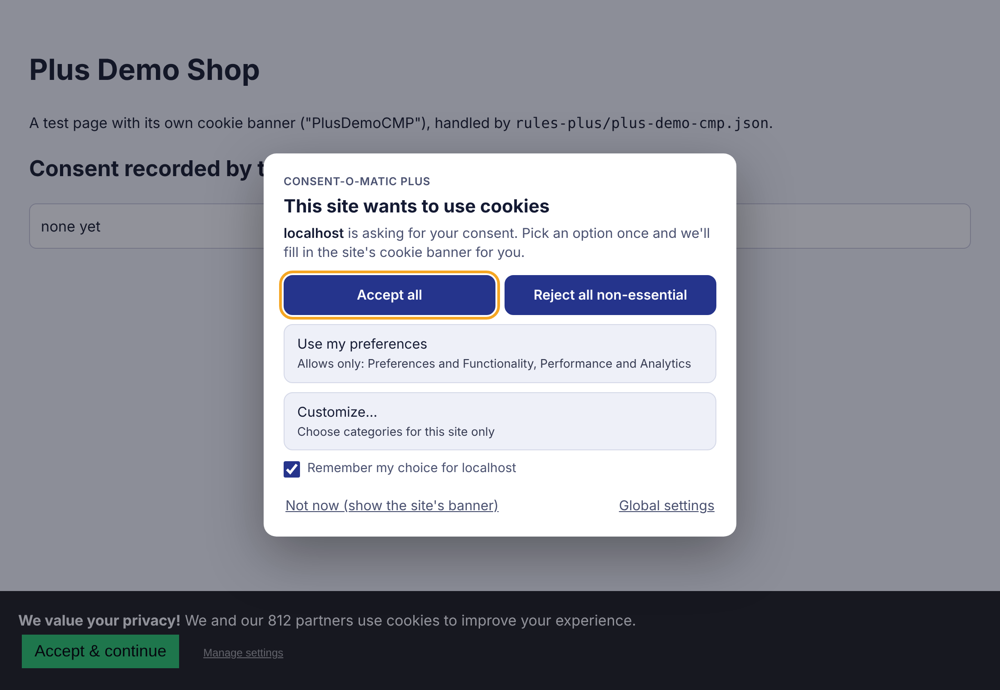
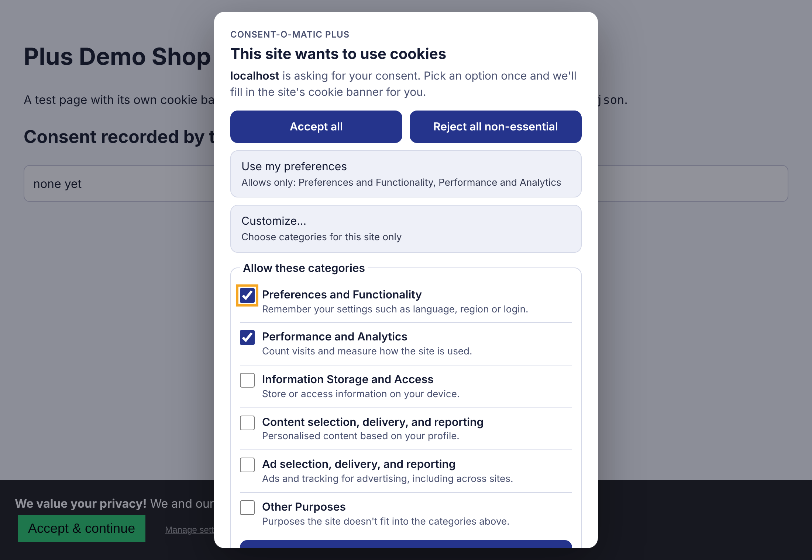
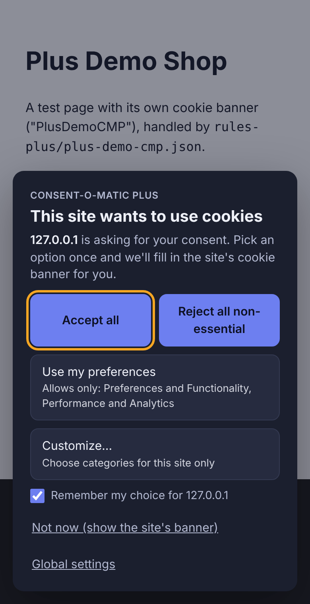
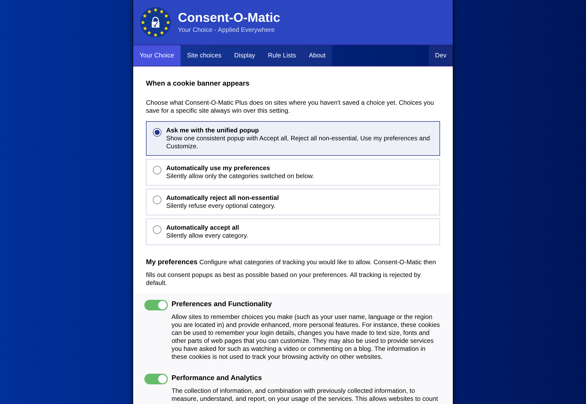
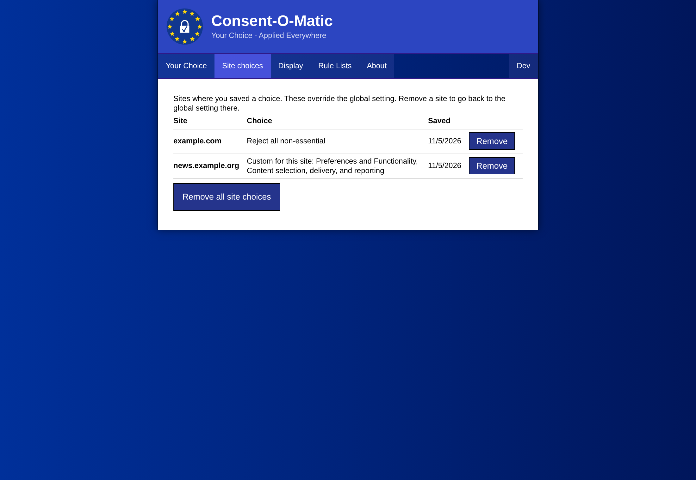
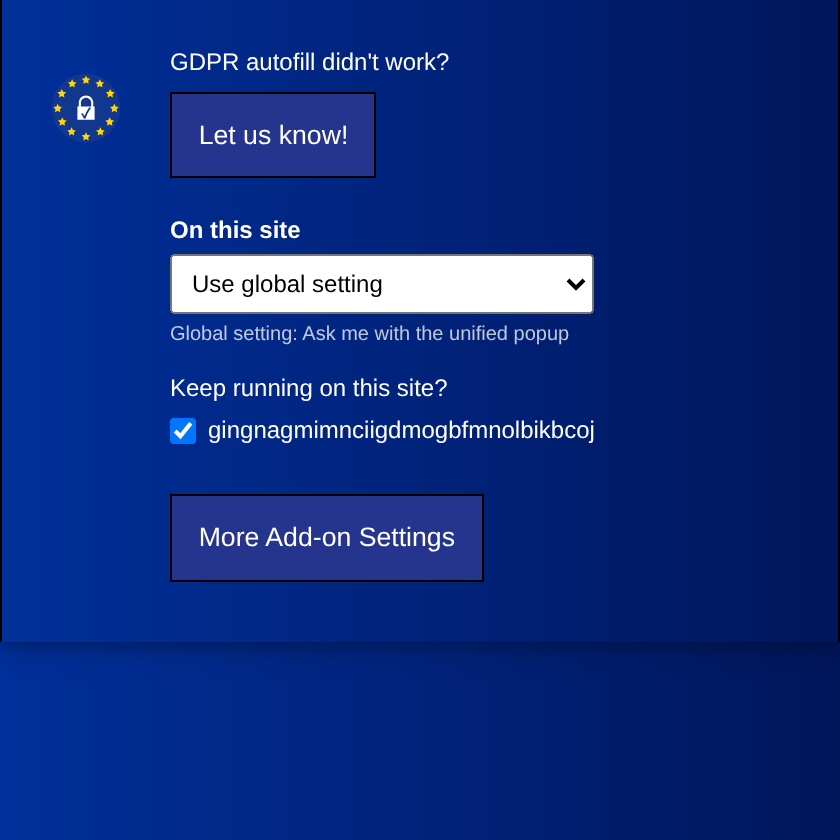
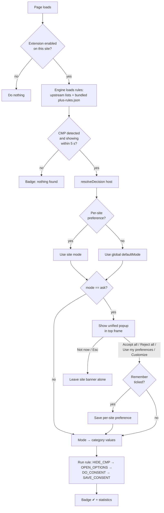

# Consent-O-Matic Plus — design & status

Consent-O-Matic Plus builds on [Consent-O-Matic](https://github.com/cavi-au/consent-o-matic): we reuse its
engine and its rule files, and add:

- **One unified popup** that replaces each site's own cookie banner. It has four choices: *Accept all*,
  *Reject all non-essential*, *Use my preferences* and *Customize*.
- **Global settings** that say what to do when a banner appears.
- **Per-site preferences** that override the global setting.
- **Our own rule files** (`rules-plus/`), bundled into the extension.

This document covers the project plan items: visual design, the extension flow chart, the backend design,
and the Phase 6 slide material.

---

## 1. Visual design

| Unified popup | Customize expanded | Mobile / dark mode |
|---|---|---|
|  |  |  |

| Options: global behaviour | Options: site choices | Toolbar popup |
|---|---|---|
|  |  |  |

**Button placement**
- *Accept all* and *Reject all non-essential* are side by side and look identical. Neither choice is pushed
  visually, unlike the site banner in the demo, where "Accept" is big and green and "Manage settings" is
  small grey text.
- *Use my preferences* shows which categories it allows (for example "Allows only: Performance and Analytics"),
  so the user knows what they are agreeing to.
- *Customize…* opens the category checkboxes inline. They start with the user's global preferences ticked.
- *Remember my choice for <site>* is ticked by default. It saves the choice as a per-site preference.
- *Not now* leaves the site's own banner alone. *Global settings* opens the options page.

**Accessibility**
- The popup is a `role="dialog"` with `aria-modal`. Keyboard focus starts on the first button and stays
  inside the popup. Esc means "Not now".
- Every button is at least 44 px tall. Focus rings are visible. The popup follows the system's dark mode
  setting and works on phone-width screens.
- Our automated tests use only the keyboard, so keyboard support is tested every time they run.

**Wording.** All new text is in `Extension/Language.js` under the `PLUS_*` keys. Only English exists so far;
other languages fall back to English.

---

## 2. Extension flow chart



**Screens and what their buttons do**

| Screen | Control | Action | Backend call |
|---|---|---|---|
| Unified popup | Accept all | Allow every category | `setSitePreference(host,{mode:"acceptAll"})` if remembered |
| | Reject all non-essential | Refuse every optional category | `{mode:"rejectAll"}` |
| | Use my preferences | Apply the global "my preferences" set | `{mode:"subset"}` |
| | Customize… → Save my choices | Apply the ticked categories | `{mode:"custom", values}` |
| | Not now / Esc | Leave the site banner alone | none |
| | Global settings | Open the options page | message `OpenOptions` |
| Toolbar popup | "On this site" dropdown | Set or clear the site's preference | `setSitePreference` |
| | Keep running on this site? | Turn the extension on or off for this site | `setPageActive` (upstream) |
| Options → Your Choice | "When a cookie banner appears" | Global default mode | `setGeneralSettings({defaultMode})` |
| | Category toggles | The "my preferences" set | `setConsentValues` (upstream) |
| Options → Site choices | Remove / Remove all | Delete per-site preferences | `setSitePreference(host,null)` / `clearSitePreferences()` |

---

## 3. Backend design

### Data model

| Key | Storage | Shape | Meaning |
|---|---|---|---|
| `generalSettings.defaultMode` | `chrome.storage.sync` | `"ask" \| "acceptAll" \| "rejectAll" \| "subset"` (default `"ask"`) | Global setting |
| `consentValues` | `chrome.storage.sync` (upstream) | `{A,B,D,E,F,X: bool}` | The "my preferences" set |
| `sitePreferences[host]` | `chrome.storage.local` | `{mode, values?, updated}` | Per-site override |

- `host` is the hostname of the top-level page, lowercased, without the port and without a leading `www.`.
- Per-site preferences are stored in `storage.local` because `storage.sync` only allows 8 KB per item, and
  this list grows without limit.

Category letters come from upstream: A Preferences/Functionality, B Performance/Analytics,
D Information storage/access, E Content, F Ads, X Other. "Essential" cookies are not a category; sites always
keep them. So *Reject all non-essential* means every category is `false`.

### How a decision is resolved (`GDPRConfig.resolveDecision`)

1. If `sitePreferences[host]` exists, use its mode.
2. Otherwise use `generalSettings.defaultMode`.
3. `valuesForMode()` turns the mode into the `{A..X}` values the engine already understands:
   - `acceptAll` → everything on
   - `rejectAll` → everything off
   - `subset` → `consentValues`
   - `custom` → the values stored with the site
   - `ask` → no values yet; the user has to be asked

### Hooking the decision into the engine

- `ConsentEngine.decisionProvider` is an optional async hook. The engine calls it after it has confirmed that
  a CMP is showing, and before it runs any rule method. The rules themselves are unchanged.
- If the hook returns `null`, the engine stops and leaves the CMP untouched.
- The 5-second "no CMP found" timeout is cleared before the user is asked, so a slow user does not stop the
  engine.

### Iframe CMPs

Many CMPs (for example Sourcepoint) run inside an iframe. A popup drawn inside that iframe would be clipped,
so the request is passed up to the top frame:

```
iframe content script --"AskUser|{host,cmp}"--> service worker
service worker --tabs.sendMessage({type:"ShowUnifiedPopup"}, {frameId:0})--> top-frame content script
top frame shows the popup --answer--> service worker --answer--> iframe engine continues
```

### Security

The popup is drawn inside a **closed** shadow root, so page scripts cannot restyle it or read it. Clicks and
key presses that a script fakes (`isTrusted === false`) are ignored. If the page removes the popup while it is
waiting for an answer, it puts it back.

### Rules

- `rules-plus/*.json` follow the same format as `rules/` (see `rules.schema.json`).
- At build time, webpack merges them into `build/plus-rules.json`. The service worker always loads that file
  last, so our rules win over upstream rules with the same name.
- `rules-plus/plus-demo-cmp.json` handles the banner on the demo site (`demo-site/index.html`). That is the
  proof of concept for "automation works on a new website with our own `.json` rule".

---

## 4. Running it

```bash
npm ci
npm run build-chromium      # output in build/
```

To load it in Chrome: open `chrome://extensions`, turn on *Developer mode*, click *Load unpacked* and pick
`build/`. To see the demo, serve `demo-site/` (for example `python3 -m http.server -d demo-site 8000`) and
open <http://localhost:8000>.

```bash
npm run test:e2e            # needs Playwright + Chromium; runs the 9 end-to-end scenarios
```

---

## 5. Phase 6 slide material

**Completed**
- Forked Consent-O-Matic and reused its engine and 200+ upstream rule files.
- Our own rule file (`rules-plus/plus-demo-cmp.json`) is bundled into the build and handles a new site
  (the demo shop) end to end.
- Unified, accessible popup with *Accept all*, *Reject all non-essential*, *Use my preferences* and
  *Customize*. It follows dark mode, fits phone screens and works by keyboard only.
- Global settings UI: the default behaviour plus the "my preferences" categories.
- Per-site preferences: saved from the popup, editable from the toolbar popup, and listed and removable in
  Options → Site choices.
- CMPs inside iframes are answered through the popup in the top frame.
- Fixed the badge for Manifest V3 (`chrome.action`). Saving one general setting no longer wipes the others.
- Automated end-to-end test (9 scenarios) that loads the real extension in Chromium.

**Left to do**
- Write and check rules for one or more *real* websites or CMPs that upstream does not cover.
- Rule generation (extra credit):
  - from one site
  - then one CMP across many sites
  - then as many CMPs as possible, using our list of CMP HTML element names to detect them
- Hide the site's banner while the unified popup is open. Right now our popup sits on top of a backdrop.
- Translate the `PLUS_*` strings.
- Rebrand: name, icon, and the "Let us know" button, which still reports to the upstream CAVI server.
- Check the Firefox and Safari builds by hand. Only Chromium is covered by the automated test.
